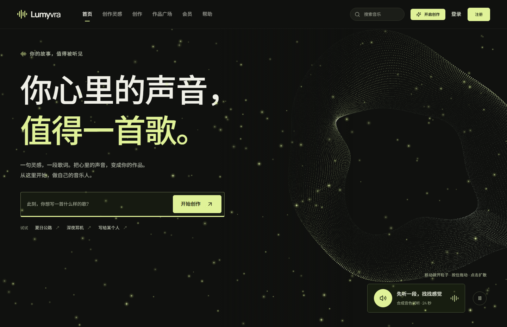
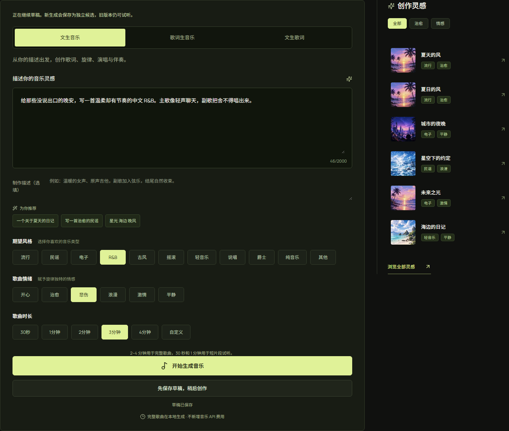
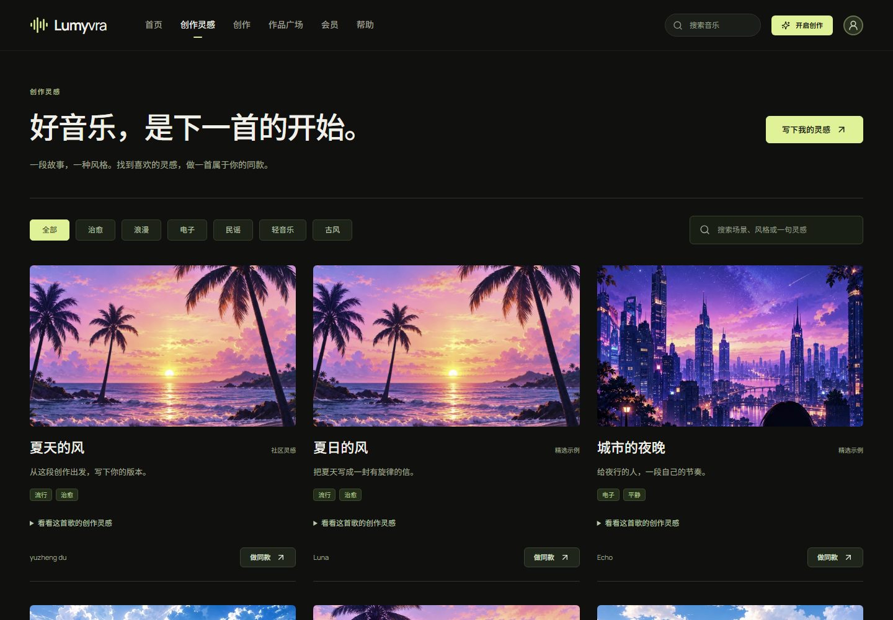
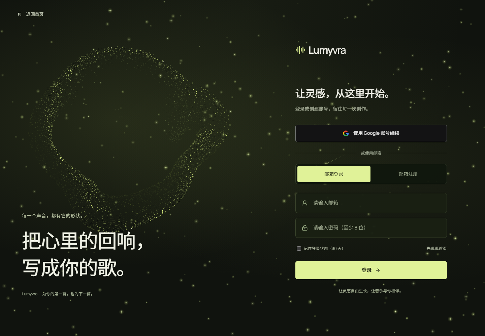
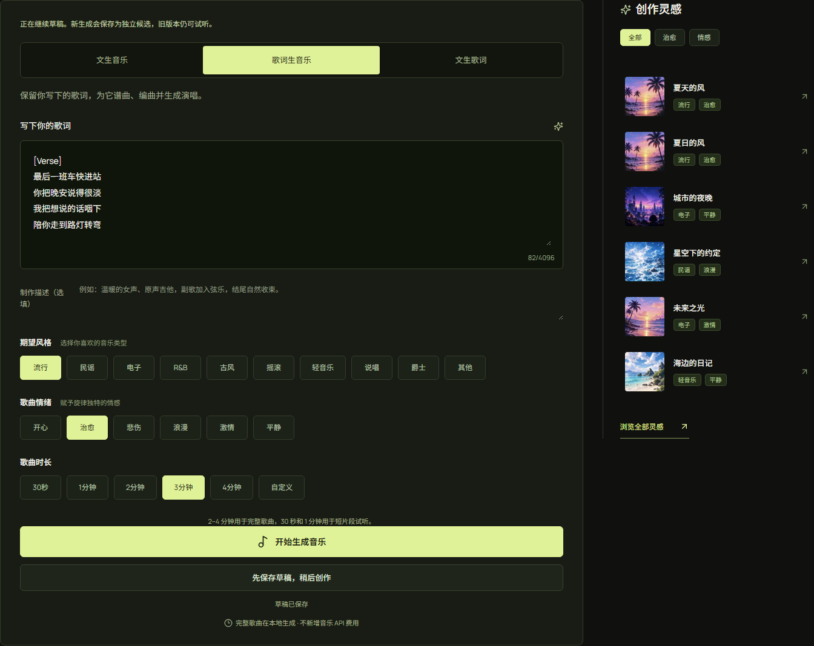
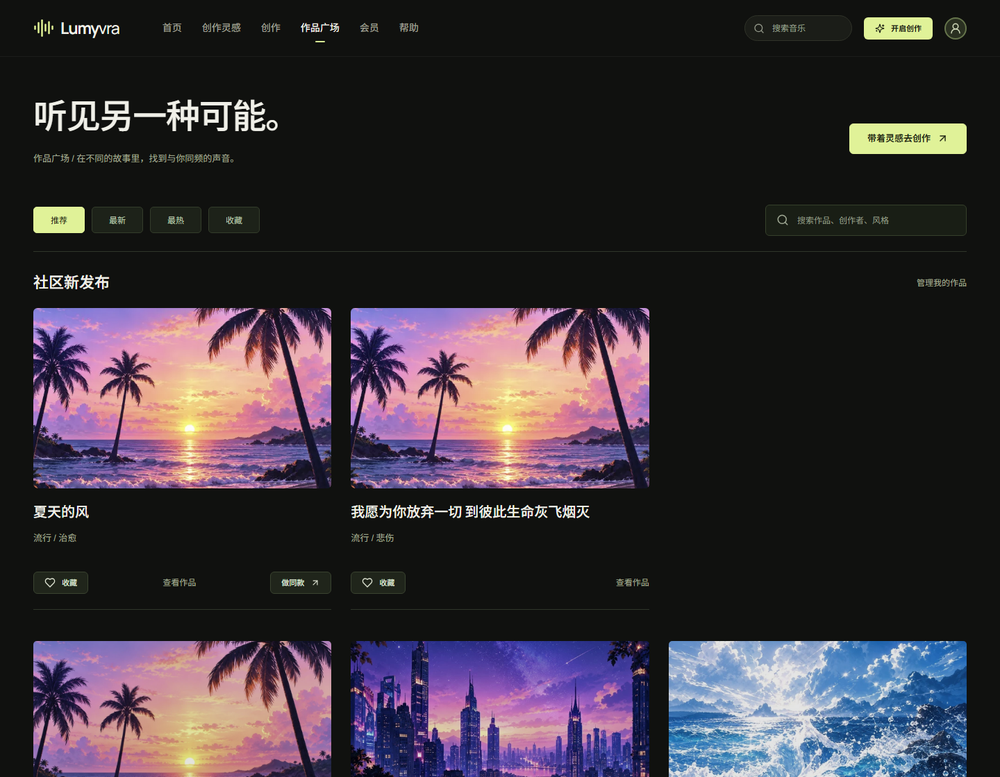
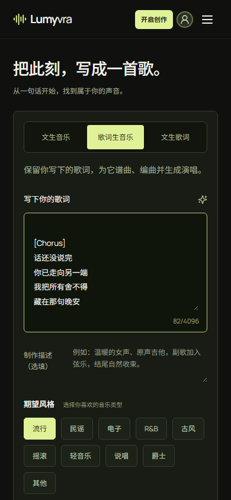
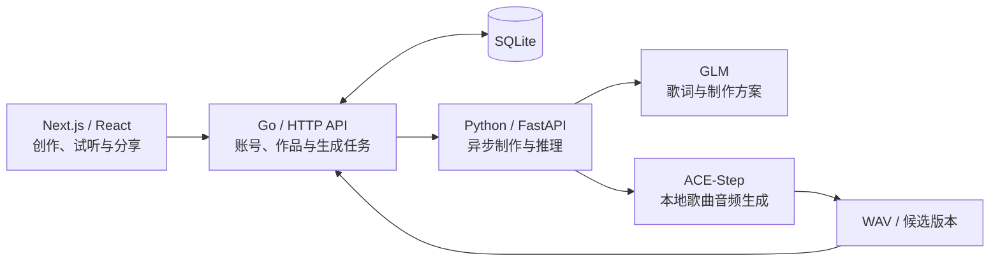

<h1 align="center">Lumyvra</h1>

<p align="center">
  <strong>从一句灵感，到一首属于你的歌。</strong><br />
  AI 音乐创作 · 沉浸式交互 · 从创作到分享
</p>

<p align="center">
  <a href="https://github.com/panderBother/lumyvra/stargazers"></a>
  
  
  
  
</p>

<p align="center">
  <a href="#界面预览">界面预览</a> ·
  <a href="#项目亮点">项目亮点</a> ·
  <a href="#技术架构">技术架构</a> ·
  <a href="#快速开始">快速开始</a> ·
  <a href="https://github.com/panderBother/lumyvra/stargazers">给项目一颗 Star</a>
</p>



**Lumyvra** 把灵感、歌词、音乐生成、试听和分享连接起来。描述一个画面、一种情绪，或带来已经写好的歌词，在同一个工作台里把它们变成音乐作品。

深色界面、荧光浅绿、可互动的粒子光场与音乐封面，让创作从打开页面的那一刻就开始。

## 项目亮点

### 三种入口，接住不同阶段的灵感

| 创作方式 | 从什么开始 | 得到什么 |
| --- | --- | --- |
| **文生音乐** | 一句话、一个故事、一种听感 | 歌词与制作方案，以及包含演唱和伴奏的歌曲音频 |
| **歌词生音乐** | 已经写好的歌词 | 保留输入原词，为文字生成音乐 |
| **文生歌词** | 想表达的主题与情绪 | 可继续编辑、用于下一次创作的歌词作品 |

### 把选择权留给创作者

风格、情绪、时长和制作描述集中在一个工作台。流行、R&B、民谣、电子、古风、摇滚等风格可以搭配不同情绪；也可以从纯音乐开始，让旋律自己说话。

### 每次尝试，都能留下来

输入自动保存为账号下的草稿。音乐任务异步执行，重新打开页面可以读取进度；重新生成保存为独立候选版本，方便试听、比较与采用。选中的作品可以导出 WAV。

### 让作品走出工作台

作品广场连接发布、检索与收藏。播放页将封面、歌词阅读、音频控制、下载与分享放在一起；创作者可以选择开放“做同款”，让自己的主题成为别人的新起点。

### 让等待与探索也有趣

首页、登录与生成界面拥有不同的粒子交互。鼠标移动、点击和拖动带来光场反馈；情绪探索、封面卡片和页面过渡共同组成统一的视觉语言。桌面与手机采用响应式布局。

## 界面预览

以下图片均来自项目的本地运行界面，创作输入使用原创示例。

### 音乐创作工作台

从主题开始，选择风格、情绪与时长，再补充想要的制作细节。



<table>
  <tr>
    <th width="50%">发现下一段灵感</th>
    <th width="50%">从登录开始的沉浸体验</th>
  </tr>
  <tr>
    <td><a href="assets/readme/03-inspiration.png"></a></td>
    <td><a href="assets/readme/05-login.png"></a></td>
  </tr>
  <tr>
    <td>从主题、风格与情绪出发，选择打动你的画面。</td>
    <td>Google与邮箱登录，保存自己的草稿与作品。</td>
  </tr>
</table>

<details>
  <summary><strong>更多实拍：歌词创作、作品广场与手机端</strong></summary>

  <p>把已经写好的歌词放进工作台；在手机上，也能随时记下刚刚出现的灵感。</p>
  <p></p>
  <p>把完成的作品发布到广场，让更多人找到你的音乐。</p>
  <p></p>
  <p align="center"></p>
</details>

## 技术架构

将浏览器体验、作品业务与音乐推理拆成三层，让创作流程与模型调用各自清晰。



| 层 | 技术 | 职责 |
| --- | --- | --- |
| **前端** | Next.js 16.4、React 19、TypeScript、Canvas / WebGL | 页面、粒子交互、创作输入、任务状态与音频播放 |
| **业务后端** | Go 1.26、`net/http`、SQLite | 登录会话、草稿、发布、收藏、版本与音频访问 |
| **推理服务** | Python 3.12、FastAPI、PyTorch、ACE-Step | 制作方案、音乐生成、独立推理进程与音频校验 |

**几个值得关注的工程设计：**

- **制作与音频分工**：GLM处理歌词和制作描述，ACE-Step负责歌曲音频；各阶段共享结构化工程信息。
- **推理进程隔离**：音乐模型按任务启动独立进程，支持取消与超时处理，HTTP服务继续负责状态与请求。
- **版本与工程分开保存**：草稿保留创作输入，生成结果保留独立候选，避免一次尝试覆盖之前的作品。
- **身份由后端校验**：账号会话使用HttpOnly Cookie，作品与音频访问按登录身份授权；推理服务使用独立私有密钥。
- **配置与运行数据分离**：模型、音频、数据库和真实凭据在本地配置，仓库维护应用代码与配置示例。

## 快速开始

以下步骤使用Windows / PowerShell。准备Node.js 22、Go 1.26、Python 3.12、Git、uv，以及用于本地音乐推理的NVIDIA CUDA运行环境。

### 1. 获取项目并准备音乐环境

```powershell
git clone https://github.com/panderBother/lumyvra.git
cd lumyvra
cd lumyvra_inference
.\scripts\setup.ps1
```

安装脚本准备Python环境、固定版本的ACE-Step源码与音乐权重，并为Go后端和推理服务配置共享私有密钥。模型权重单独下载到本地，首次安装请预留相应磁盘空间。

### 2. 配置制作助手与登录入口

在本地`.env`中填写所选服务的配置。字段说明见[推理配置示例](lumyvra_inference/.env.example)和[后端配置示例](lumyvra_backend/.env.example)。

| 文件 | 配置项 | 用途 |
| --- | --- | --- |
| `lumyvra_inference/.env` | `GLM_BASE_URL`、`GLM_API_KEY`、`GLM_MODEL` | 歌词与制作方案服务 |
| `lumyvra_backend/.env` | `GOOGLE_CLIENT_ID`、`GOOGLE_CLIENT_SECRET`、`GOOGLE_REDIRECT_URL` | Google登录 |
| `lumyvra_backend/.env` | `SMTP_HOST`、`SMTP_PORT`、`SMTP_TLS_MODE`、`SMTP_USERNAME`、`SMTP_PASSWORD`、`SMTP_FROM` | 邮箱验证码注册 |

账号入口可选择Google登录或邮箱验证码注册。Google本地回调地址为`http://localhost:3000/api/auth/google/callback`，与Google控制台配置一致即可。

### 3. 在三个终端启动服务

在仓库根目录分别打开三个终端：

**音乐推理 · 8090**

```powershell
cd lumyvra_inference
.\.venv\Scripts\python.exe run.py
```

**业务后端 · 8080**

```powershell
cd lumyvra_backend
go run ./cmd/server
```

**创作界面 · 3000**

```powershell
cd lumyvra_fronted
npm ci
npm run dev
```

打开 **http://localhost:3000**，登录后即可进入自己的创作工作台。

## 项目目录

```text
lumyvra/
├── assets/readme/       项目实拍截图
├── lumyvra_fronted/     Next.js页面、交互组件与静态资源
├── lumyvra_backend/     Go接口、账号、作品与SQLite存储
└── lumyvra_inference/   Python制作助手、音乐推理与音频处理
```

## 一起把灵感做成作品

欢迎通过[Issue](https://github.com/panderBother/lumyvra/issues)分享使用反馈，也欢迎提交Pull Request，一起打磨创作体验、交互与工程实现。

感谢[Next.js](https://github.com/vercel/next.js)、[React](https://github.com/facebook/react)、[FastAPI](https://github.com/fastapi/fastapi)、[ACE-Step](https://github.com/ace-step/ACE-Step-1.5)与相关模型、工具的建设者。

<p align="center">
  <strong>如果你喜欢这个项目，欢迎点亮右上角的 ⭐ Star。</strong><br />
  让Lumyvra留在你的项目清单里，也让下一份音乐灵感有个起点。
</p>
